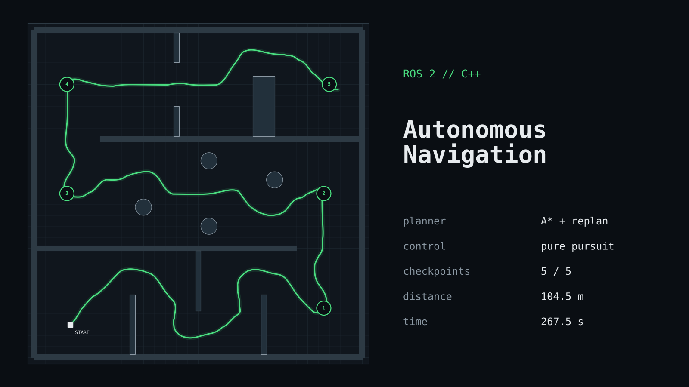
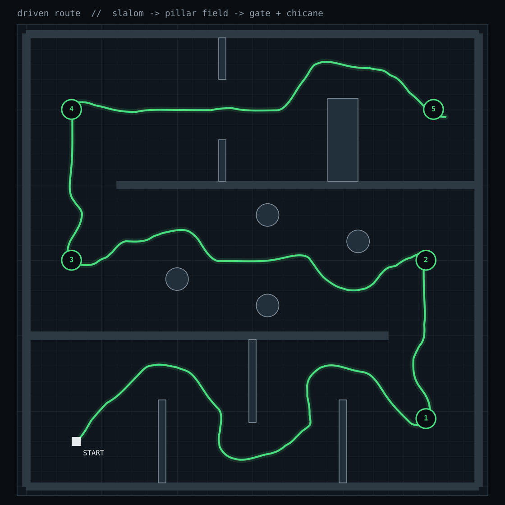
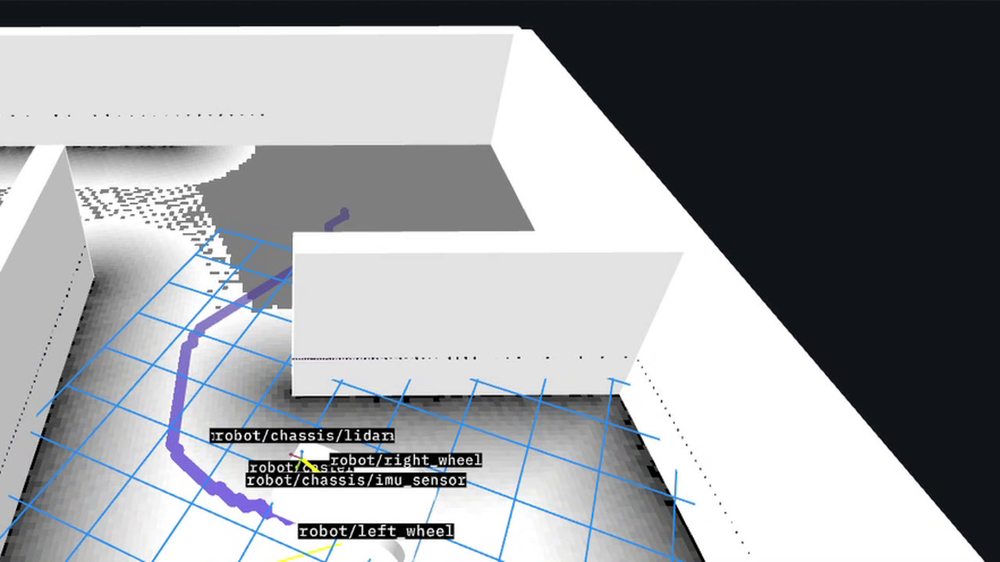
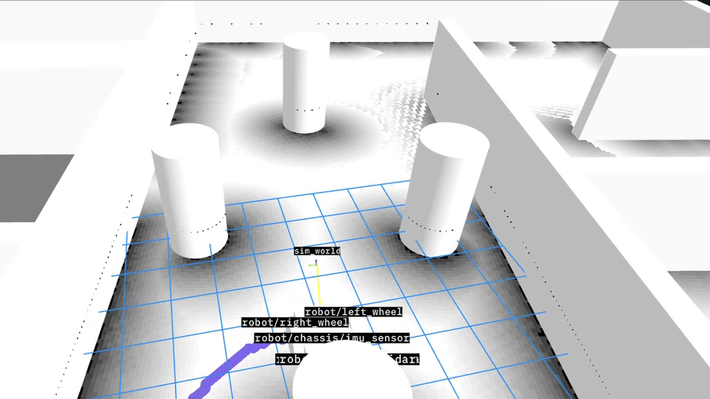
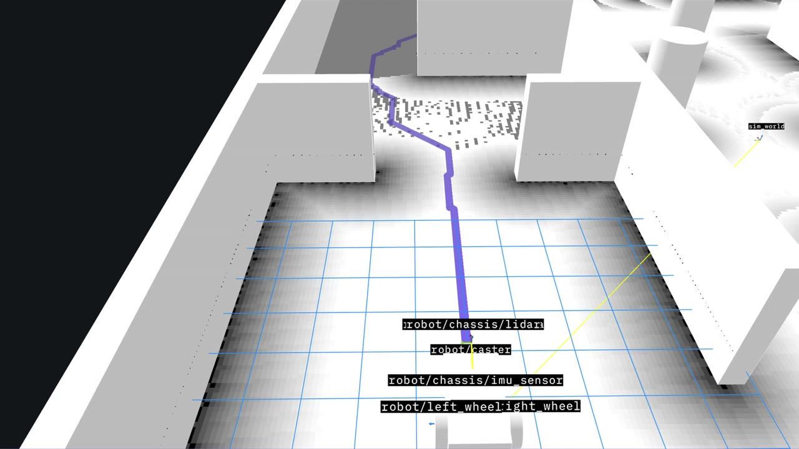

# Autonomous Navigation Stack (ROS 2 · C++ · Gazebo)



A lidar-based navigation stack that drives a differential-drive robot through a 5-checkpoint obstacle course in Gazebo, with no collisions.

**[▶ Watch the demo](https://nithipan.vercel.app/projects/nav-demo.mp4)** · [demo file in this repo](docs/media/demo.mp4) · [portfolio](https://nithipan.vercel.app)

| Result (Gazebo) | |
|---|---|
| Checkpoints | **5 / 5** |
| Distance | **104.5 m** |
| Time | **267.5 s** |
| Collisions | **0** |

Built on the [WATonomous ASD training framework](https://github.com/WATonomous/wato_asd_training), which provides the Docker/Gazebo/Foxglove infrastructure and empty node templates. The four navigation nodes, the mission planner, the obstacle course, and the fixes below are my own work.

---

## Architecture

```
/lidar ──► Costmap ──/costmap──► Map Memory ──/map──► Planner ──/path──► Control ──/cmd_vel──► robot
                                     ▲                  ▲  ▲                 ▲
/odom/filtered ──────────────────────┴──────────────────┘  │                 │
                                                           └─ checkpoints    └─ /odom/filtered
```

| Node | What it does |
|---|---|
| **Costmap** (`src/robot/costmap`) | Converts each lidar beam from polar to grid coordinates, ray-traces free space, marks hits as obstacles, and inflates them linearly (`cost = 100·(1 − d/r)`, r = 2.2 m). |
| **Map Memory** (`src/robot/map_memory`) | Fuses the robot-frame costmap into a global map using odometry (x, y, yaw) every 1.5 m. Uses inverse mapping (global cell → costmap cell), so rotation never leaves holes. |
| **Planner** (`src/robot/planner`) | 8-connected **A\*** with an octile heuristic and a cost-weighted step. Runs a mission state machine over a checkpoint queue and replans when the map shows the path is blocked. |
| **Control** (`src/robot/control`) | **Pure pursuit** at 10 Hz: picks a lookahead point and steers along the arc to it (`ω = v·2·sin α / L`), turning in place when the target is behind. |

## The obstacle course



Generated by [`tools/course/generate_course.py`](tools/course/generate_course.py), which writes the Gazebo world, the Foxglove model, and the plot from one layout:

1. **Slalom**: walls alternating from each side force an S-curve.
2. **Pillar field**: offset pillars, one of which can only be passed through a centre gap.
3. **Gate + chicane**: a 4 m doorway, then a block that forces the robot up and over.

| Slalom | Pillar field + costmap | A* path through the gate |
|---|---|---|
|  |  |  |

## Problems I hit and fixed

**1. The robot's body clipped walls.**
The planner and controller were steering the *lidar*, which sits 1.3 m ahead of the wheels. On every turn the back of the robot cut the corner. I fixed it by planning and tracking from the **rear axle**, the point a differential drive rotates about, and by sizing inflation to the robot's 1.6 m turning radius plus a margin.

**2. The robot froze in the pillar field.**
With a pillar dead-centre between two checkpoints, going above it and going below it cost almost the same. Every map update flipped the plan, and the robot turned left, then right, forever until it timed out. I fixed it with three changes:
- **Path commitment.** The planner keeps the current path and replans only if it becomes blocked or the robot strays more than 1.5 m from it.
- **Cost hysteresis.** Paths are planned at cost < 22 but only count as blocked at cost ≥ 35, so noise at obstacle edges can't trigger replans.
- **Previous-path bias.** Replans discount cells near the old route (×0.8), so they stay on the same side unless the other side is clearly better.

## Run it

Needs Docker (Linux, or Windows with WSL 2 + Docker Desktop).

```bash
# watod-config.sh
ACTIVE_MODULES="robot gazebo vis_tools"

./watod build
./watod up        # the robot starts the course ~2 s after launch
```

Open [Foxglove](https://app.foxglove.dev), connect to `ws://localhost:<FOXGLOVE_BRIDGE_PORT>`, and show `/map`, `/path` and `/waypoints`. Click with the **Publish → Point** tool on `/goal_point` to queue your own goals.

Tuning lives in each node's `config/params.yaml`. To use the original WATonomous world instead of the course: `WATO_WORLD=robot_env.sdf`.

<details>
<summary>Course and route tools</summary>

```bash
python3 tools/course/generate_course.py               # regenerate world + model from the layout
python3 tools/course/extract_route.py bag.db3 r.json  # pull the driven route out of a ROS 2 bag (no ROS needed)
python3 tools/course/plot_route_dark.py r.json out/   # render route images
```
</details>

## License

Apache 2.0, inherited from the WATonomous framework.
